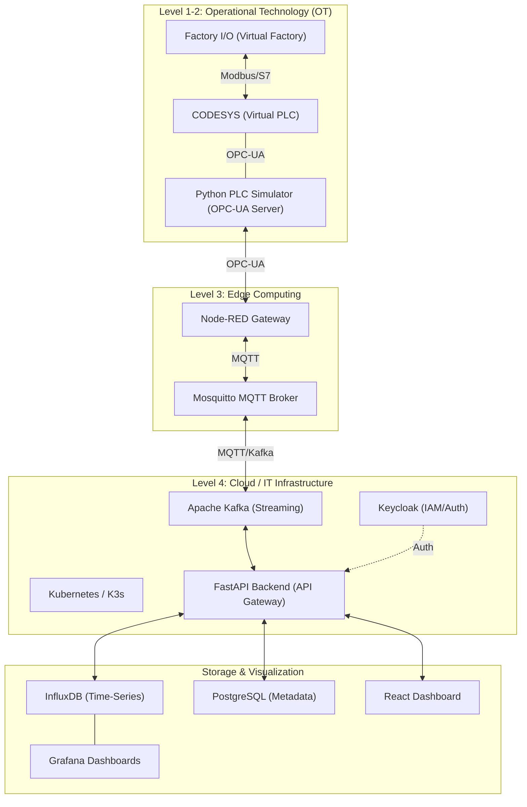

# 📘 Technical Documentation: Cloud Industrial Platform

## 1. 🏗️ High-Level Architecture
The platform follows the **ISA-95** industrial automation model, structured into 4 distinct layers to ensure security, scalability, and real-time performance.

---

## 2. 📡 Communication Protocols

| Interface | Protocol | Description |
| :--- | :--- | :--- |
| **Factory ↔ PLC** | **OPC-UA / Modbus** | Low-latency industrial protocols for sensor/actuator control. |
| **PLC ↔ Edge** | **OPC-UA** | The standard for vendor-neutral industrial data exchange. |
| **Edge ↔ Cloud** | **MQTT** | Lightweight pub/sub protocol ideal for unstable networks and high frequency. |
| **Cloud ↔ App** | **REST / WebSockets**| Standard IT protocols for dashboards and management APIs. |
| **Streaming** | **Kafka** | High-throughput distributed messaging for "Big Data" analytics. |

---

## 3. 🔄 Data Workflows

### A. Telemetry Flow (Sensor → Dashboard)
1.  **Generation**: **Factory I/O** generates physical sensor data (e.g., Temperature).
2.  **Logic**: **CODESYS PLC** reads the sensor and executes control logic.
3.  **Exposition**: The **OPC-UA Server** (Simulator) exposes these values as Nodes.
4.  **Ingestion**: **Node-RED** polls the OPC-UA nodes every 1s.
5.  **Translation**: Node-RED converts the data to a JSON payload and publishes to `factory/line1/telemetry`.
6.  **Distribution**: **Mosquitto** routes the message to the **FastAPI Backend** and **InfluxDB**.
7.  **Visualization**: **Grafana** queries InfluxDB to display real-time trends.

### B. Control Flow (User → Machine)
1.  **Command**: User clicks "STOP" on the **React Dashboard**.
2.  **Validation**: **FastAPI** checks JWT permissions via **Keycloak**.
3.  **Dispatch**: FastAPI publishes a command message to `factory/commands/PLC_01`.
4.  **Reception**: **Node-RED** receives the MQTT command.
5.  **Execution**: Node-RED writes the "STOP" value back to the **OPC-UA** Status node.
6.  **Action**: **CODESYS** detects the change and stops the virtual motor in **Factory I/O**.

---

## 4. 🛠️ Component Breakdown

### **Edge Gateway (Node-RED)**
*   **Role**: Protocol bridge and local data processing.
*   **Logic**: Filters noise, aggregates data, and handles local alarms if the cloud is offline.

### **Cloud Backend (FastAPI)**
*   **Role**: Orchestrator and API Gateway.
*   **Logic**: Manages device registries, handles authentication, and routes control commands.

### **Identity Management (Keycloak)**
*   **Role**: Security.
*   **Logic**: Implements **Zero Trust** architecture, ensuring only authorized operators can send "START/STOP" commands.

### **Observability (Grafana + Prometheus)**
*   **Role**: Health monitoring.
*   **Logic**: Grafana monitors the **Factory** (OT metrics), while Prometheus monitors the **Servers** (IT metrics).

---

## 🔒 5. Security Principles
1.  **Network Segmentation**: OT (PLC) and IT (Internet) never communicate directly; the **Edge Gateway** acts as a DMZ.
2.  **Encryption**: All MQTT and REST traffic is secured via **TLS 1.3**.
3.  **Audit Logging**: Every command sent to a machine is logged in PostgreSQL for forensic analysis.
